# sun_bot: a robot that keeps a potted plant in the sun

A small differential-drive robot carries a potted plant around a closed warehouse and keeps it in
the sunlight. The warehouse (20 x 12 m, with a roof) has three 2 m windows facing east, south and
west, so the sun only gets in through them: the bright patches on the floor move, shrink and
vanish as the sun crosses the sky. The robot maps the room, learns on day 1 where the sun lands
at each hour, and from day 2 on drives to the sun, creeps into it with four edge light sensors,
follows it as it moves, waits out clouds, and honks when the plant is thirsty. Everything runs in
simulation with ROS 2 Humble, Gazebo Fortress and Nav2 (on WSL2, Ubuntu 22.04), with a
physically based sun for Jabalpur, India (23.18 N, 79.95 E).

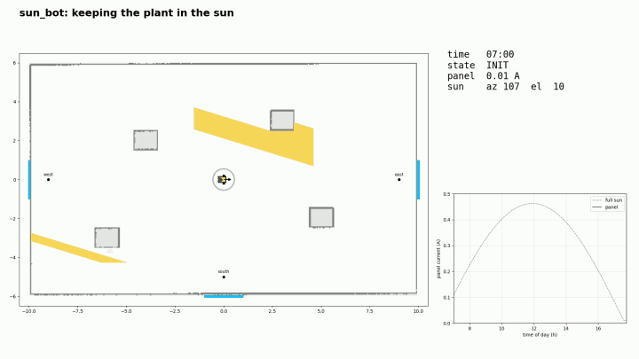

*Top-down replay of one simulated day (4x faster than the recording): yellow = sunlight on the
floor, blue line = the robot's path, ring colour = what the robot is doing.*

## Videos

| What | Link |
|---|---|
| Final demo: a whole day, sun tracking, cloud, thirsty plant | [YouTube](https://youtu.be/Y-nxJU4SM40) |
| Robot following the sun (east window), map and simulation side by side | [YouTube](https://youtu.be/7o5_FzFHMYk) |
| The plant buzzing when it dries out | [YouTube Shorts](https://youtube.com/shorts/SMcU9C-fGbg) |
| Sunset problem (before the fix) / after the fix | [before](https://youtube.com/shorts/VkYxcWIFjiU) / [after](https://youtu.be/rzIwbqcoyaE) |
| Driving with the lidar, obstacles in red | [YouTube](https://youtu.be/37CWU87PLBA) |
| Building the map live (SLAM) | [YouTube](https://youtu.be/y3u-i91V3TA) |
| Nav2 driving to the windows | [YouTube](https://youtu.be/jt4Z89O806I) |

## Results

Same simulated day, same random clouds, three strategies (headless runs, final code):

| Strategy | Panel in the sun | Sun energy | Distance driven |
|---|---|---|---|
| Park at the best window spot (south) | 32 % of daylight | 0.82 A·h | 5 m |
| Greedy: wander and follow the light sensors, no map | 19 % | 0.42 A·h | 97 m |
| **sun_brain: learn where the sun lands, then chase it** | **50 %** | **1.27 A·h** | 37 m |

**sun_brain collects 54 % more sun energy than the best parking spot and 3x more than greedy.**

- *In the sun* = at least half of the 10 W panel inside a sun patch. *Sun energy* = panel current
  above the indoor-light floor, integrated over the day.
- **Why parking is not enough:** each window's patch covers its parking spot for only part of the
  day (east 08:45-09:40, south 10:05-14:05, west 14:12-15:07), because the patches slide across
  the room with the sun.
- **Why greedy fails:** indoor light is the same almost everywhere (about 300 lux), so away from a
  patch the light sensors give no hint which way the sun is; there is nothing to follow until the
  robot is already touching a patch. Patches cover only about 1 % of the floor at any moment, so
  wandering blindly rarely finds one (0-19 % over three runs: mostly luck).

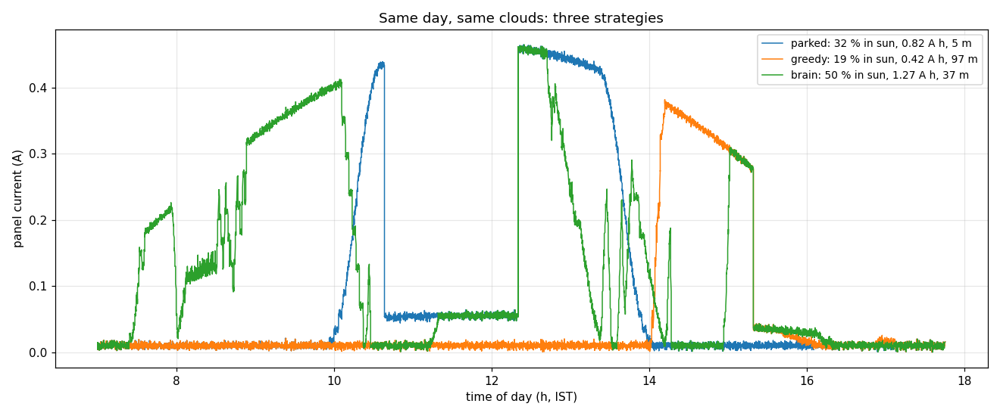

More: [results.md](docs/results.md), [SUMMARY.md](docs/SUMMARY.md) (one-page project summary),
[TASK7_WALKTHROUGH.md](docs/TASK7_WALKTHROUGH.md) (one full day, screenshot by screenshot).

## How it works

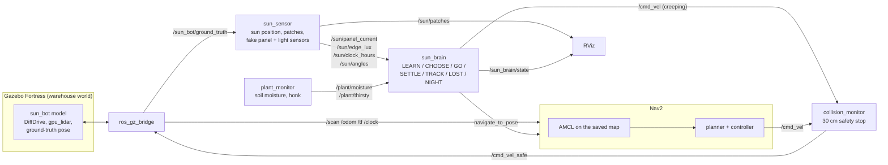

- **sun_sensor** plays the physical world: it computes the sun position (NOAA equations), casts
  each window's light onto the floor (with the window reveal and the pallets' shadows), and fakes
  the robot's sensors from its true pose: a 10 W panel on top (current in A) and four light
  sensors on the body edges (lux), plus random clouds.
- **sun_brain** only uses what a real robot has: its AMCL pose, the panel current, the edge
  sensors, the lidar and the clock. On day 1 (LEARN) it surveys every sunlit window every two
  hours and saves the best spot per hour in `config/learned_sun.yaml`. From day 2 it picks the
  best learned spot for the arrival time (CHOOSE), drives there with Nav2 (GO), creeps into the
  light (SETTLE), follows the patch (TRACK), holds still in a cloud (LOST: everything dims at
  once), and parks for the night (NIGHT).
- **Safety:** every motion goes through Nav2 or `/cmd_vel`, and so through the collision monitor,
  which stops the robot when anything is within 30 cm of its body.

### Simulated sensor vs real part

| In the simulation | Real part | Notes |
|---|---|---|
| Panel current (`/sun/panel_current`, 0.55 A in full sun) | 10 W solar panel + INA219 current sensor | 0.55 A x ~18 V = 10 W; the INA219 (0.1 ohm shunt, up to 3.2 A) reads it directly. The panel must feed a load or charger for the current to mean anything. |
| 4 edge light sensors (`/sun/edge_lux`) | VEML7700 (up to ~120k lux), or BH1750 behind a diffuser | The sim reads ~60k lux in the sun (up to ~80k lux at noon). A BH1750 saturates at ~65k lux at its default sensitivity, so it would clip in direct sun: use a VEML7700, or put a diffuser (or a lower-sensitivity setting) on the BH1750. ~300 lux indoors is easy for both. |
| 360-degree lidar (10 m, 360 rays, 10 Hz) | RPLidar A1 | 12 m range, 360 degrees, ~5.5 Hz scans; plenty for a 20 x 12 m room. |
| Ground-truth pose (only used by `sun_sensor` to fake the light) | none needed: AMCL on the real lidar | On hardware the sensors read the real light, so no ground truth is used anywhere; `sun_brain` already navigates with AMCL on the lidar. |
| Plant moisture (`plant_monitor`) | Capacitive soil-moisture probe | Capacitive rather than resistive probes, which corrode in wet soil. |

## Build log

From the project notes, in the order it was built.

**1. The warehouse.** 20 x 12 m, a roof, three 2 m windows (east, south, west; glass from 1.0 to
2.2 m), four pallets. Generated by `worlds/make_world.py`.

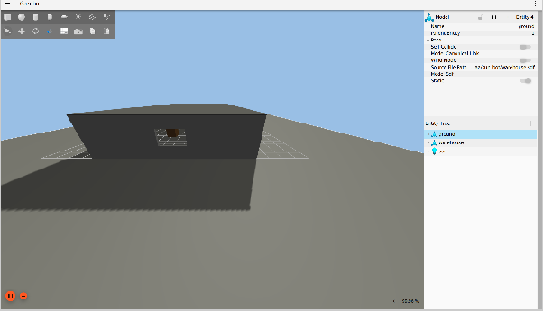 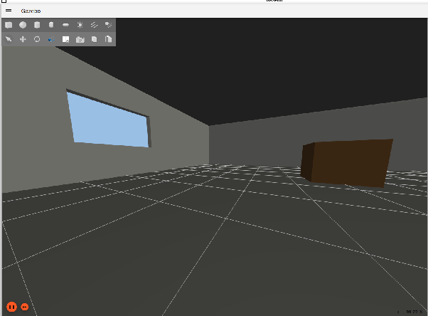

**2. The robot.** A 0.4 x 0.3 m box on two wheels and a caster, with the plant pot on top and a
360-degree lidar (the black cylinder) to map the floor and detect obstacles. A depth camera would
be more accurate but more expensive, so it is left as a possible upgrade.

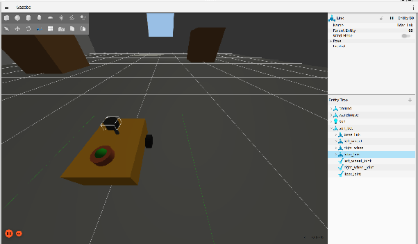 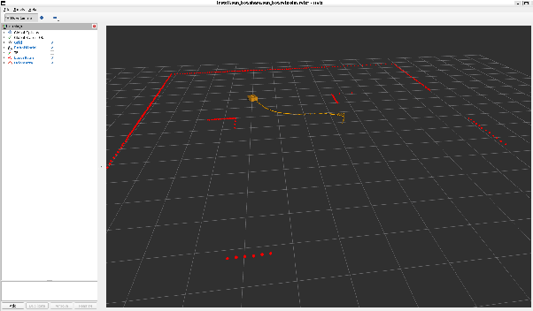

**3. Mapping.** slam_toolbox builds the map while the robot drives a fixed route. The lidar scans
at 0.26 m, below the windows (1.0-2.2 m), so the map shows solid walls there: the windows and a
parking spot in front of each are marked by hand from the building plan
(`config/windows.yaml`).

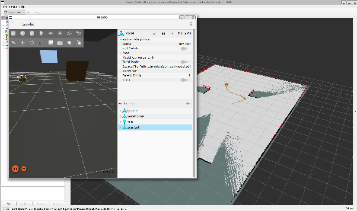 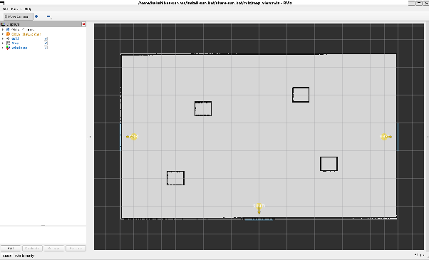

**4. Navigation.** Nav2 drives to each window's parking spot (all three reached, about 0.1 m
and under 5 degrees from the target) and can loop back to where it started.

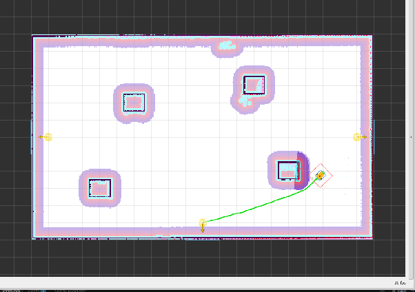 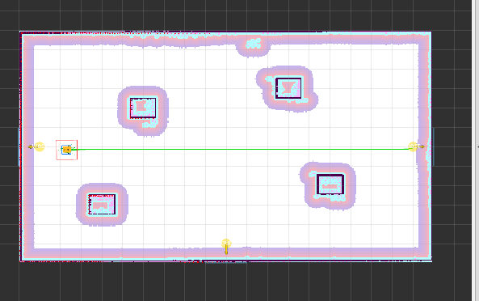

**5. Safety stop.** People move; boxes don't. To test a sudden obstacle, a 0.3 x 0.3 x 0.5 m box
was spawned 0.28 m in front of the robot while it drove east at 0.25 m/s. The collision monitor
stopped it 0.13 m from the box; it stayed stopped while the box was there and carried on to the
east window once the box was removed. Trade-off: an object that *stays* inside the 30 cm zone
blocks the robot until it moves away (the stop zone also blocks turning and backing up). In
normal driving the lidar sees obstacles 10 m away and Nav2 plans around them long before that.

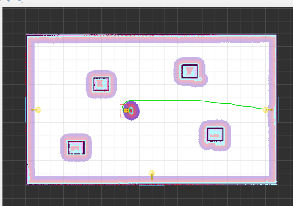

**6. The sun.** The sun's position is calculated for the date, time and location (sunrise 06:09,
noon elevation 55 degrees, sunset 17:39 on 23 October), and the light through each window is
projected onto the floor. The patches move across all three windows during the day: here all
the patches in RViz, the west patch next to the robot in the afternoon, and the south patch at
the end of a planned path.

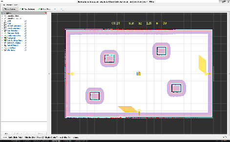 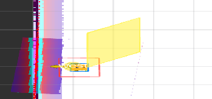 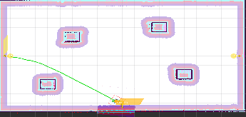

**7. Following the sun.** The robot now follows the sunlight from all three windows; the
plant's soil dries faster in the sun and the robot buzzes when it is thirsty.

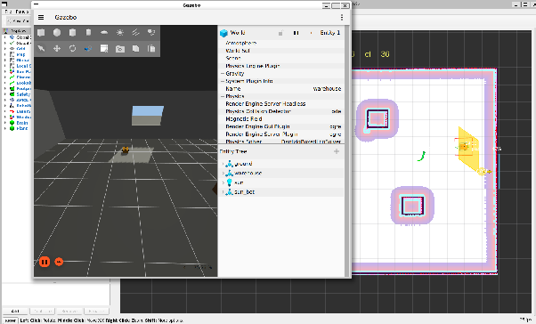

**8. The sunset problem and its fix.** At sunset the west patch races across the room towards
the east and disappears, and the robot didn't know what to do. Fixed: the robot looks around
before giving up, never creeps so close to a wall that the safety stop traps it, and tells a
cloud from a patch that has moved. Pallets also cast shadows now. Gazebo cannot show the moving
sun (a rendering limitation: Fortress cannot move lights at runtime), so the sun view is RViz.

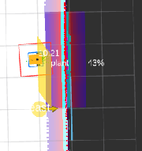 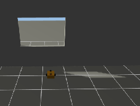 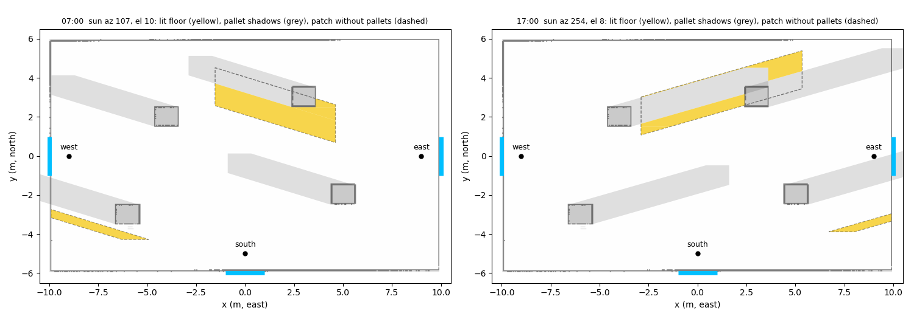

**9. A whole day.** Panel current against the full-sun curve, what the robot was doing, two
clouds (grey) and the plant's moisture (thirsty in red, then watered).


## Run it

Tested on Ubuntu 22.04 (WSL2 on Windows 11) with ROS 2 Humble and Gazebo Fortress.

```bash
# dependencies
sudo apt install ros-humble-desktop ros-humble-ros-gz ros-humble-navigation2 \
  ros-humble-nav2-bringup ros-humble-slam-toolbox ros-humble-sdformat-urdf \
  ros-humble-teleop-twist-keyboard python3-opencv python3-matplotlib python3-scipy imagemagick

# workspace
mkdir -p ~/sun_ws/src && cd ~/sun_ws/src
git clone https://github.com/hahahibaa/sun_bot.git
cd ~/sun_ws && colcon build --symlink-install && source install/setup.bash
```

| Step | Command |
|---|---|
| Warehouse + robot only (teleop with `teleop_twist_keyboard`) | `ros2 launch sun_bot sim.launch.py` |
| Build a new map (sim + SLAM), drive the route, save | `ros2 launch sun_bot mapping.launch.py` then `ros2 run sun_bot tour` and `ros2 run nav2_map_server map_saver_cli -f ~/sun_ws/src/sun_bot/maps/warehouse --ros-args -p use_sim_time:=true` |
| Navigation to the windows | `ros2 launch sun_bot nav.launch.py` then `ros2 run sun_bot go_to_window all` |
| Day 1: learn where the sun lands (~13 min) | `ros2 launch sun_bot sun_day.launch.py mode:=learn gui:=false rviz:=false` |
| Day 2: chase the sun (Gazebo + RViz) | `ros2 launch sun_bot sun_day.launch.py clouds:=true` |
| Baselines | `ros2 launch sun_bot sun_day.launch.py strategy:=parked` (or `strategy:=greedy`) |
| Scripted demo day (cloud ~11:00, thirsty ~14:00, watered 15:00) | `ros2 launch sun_bot sun_day.launch.py demo:=true` (add `beep:=true` for the sound) |
| Record the demo (RViz, 5x time-lapse) | `bash ~/sun_ws/src/sun_bot/scripts/record_demo.sh` |
| Log a day and plot it | add `log:=/tmp/day.csv`, then `ros2 run sun_bot sun_report --day-run /tmp/day.csv` |
| Compare strategies | `ros2 run sun_bot sun_report --compare parked.csv greedy.csv brain.csv` |
| Top-down replay video from a log | `ros2 run sun_bot sun_replay /tmp/day.csv --out replay.mp4` |
| Sun table, patch plot, distances (no sim) | `ros2 run sun_bot sun_report` |
| Make a cloud / water the plant | `ros2 service call /sun/cloud std_srvs/srv/Trigger` / `ros2 service call /plant/water std_srvs/srv/Trigger` |

**WSL2 notes.**
- gpu_lidar returns nothing useful on WSL's GPU driver, so the Gazebo server renders with
  software OpenGL (the GUI keeps the GPU): `sim.launch.py` does this by default.
- If ROS behaves strangely, check the Linux clock isn't jumping
  (`sudo systemctl disable --now systemd-timesyncd` fixed it here).
- After a crashed run, `ros2 daemon stop` and `rm /dev/shm/fastrtps_*` clear stuck DDS state.

## Known limitations

- Low evening sun throws long streaks that race across the room; the robot often can't keep up.
- Patches pressed against a wall can't be reached: the safety stop keeps the robot's body away
  from walls (by design), and the panel sits in the middle of the body.
- Day 1 learning freezes the simulated clock during each survey; a real robot would learn over a
  few days or keep updating its table.
- The sun and sensors are simulated: geometric light, no reflections or diffuse daylight changes,
  no self-shadow. Gazebo cannot show the moving sun; RViz is the sun view.
- An object that stays inside the 30 cm stop zone blocks the robot until it moves away.
- Clouds are recognised by everything dimming at once; a slow, thin cloud could look like a
  moving patch.

## Repository layout

```
config/    windows.yaml (windows, parking spots, pallets), nav2_params.yaml, slam_toolbox.yaml,
           learned_sun.yaml (day-1 result)
launch/    sim, mapping, nav, view_windows, sun_day (learn / run / baselines / demo)
models/    sun_bot robot (SDF)          worlds/   make_world.py + warehouse.sdf
maps/      saved SLAM map               rviz/     RViz layouts (sim, nav, map_view, demo)
sun_bot/   nodes: sun_sensor, sun_brain, plant_monitor, go_to_window, tour, wander,
           window_markers, demo_director; tools: solar, sun_geometry, sun_logger, sun_report,
           sun_replay, record_window, demo_finish
scripts/   record_demo.sh               docs/     results, summary, walkthrough, figures
```

## License

Apache-2.0 (see `LICENSE`).
